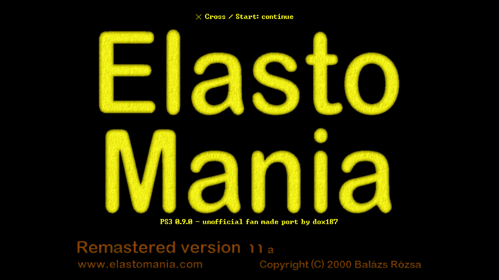
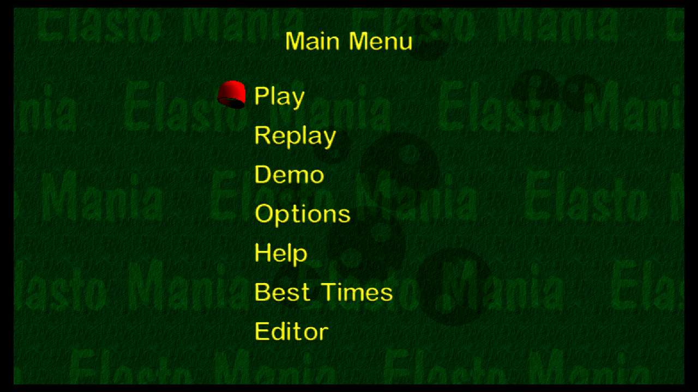
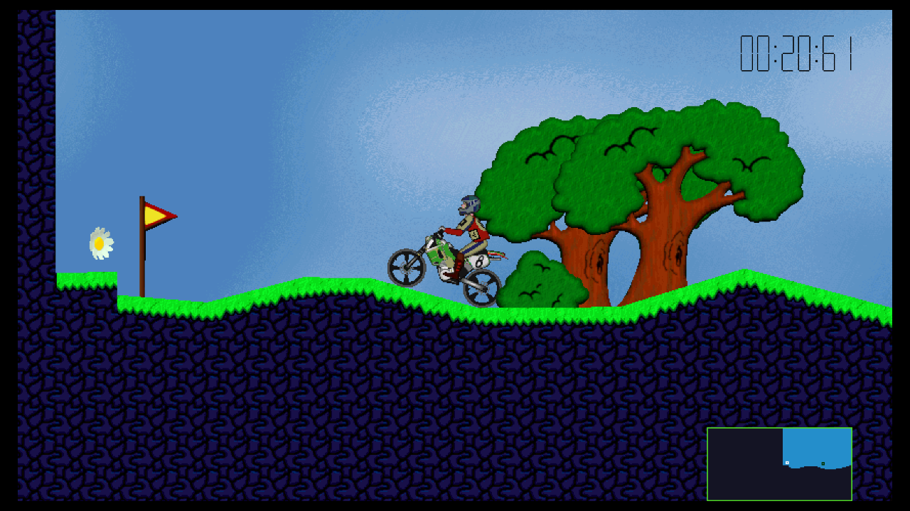
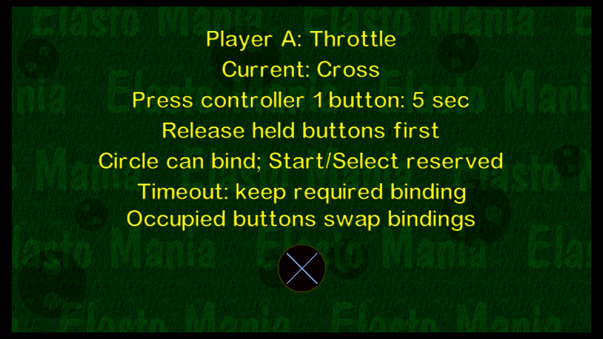

# Elasto Mania Classic for PS3

Native PowerPC/PSL1GHT build of the original shared engine and SDL2 desktop
platform. The PS3 target defines `ELMA_PS3` and uses SDL2 for video, controllers,
keyboard and sound. Registered game assets must be supplied separately.

<p>
  <a href="docs/title.png"></a>
  <a href="docs/menu.png"></a>
</p>
<p>
  <a href="docs/gameplay.png"></a>
  <a href="docs/controller.png"></a>
</p>

Title screen, main menu, Warm Up and controller configuration, captured from
version 0.9.0 in RPCS3 at 1280×720. Click an image to view it at full size.

## Build

On Linux x86_64 with CMake, Make, Python 3, patch, curl, tar, gzip and sha256sum:

```sh
console/ps3/tools/bootstrap.sh
console/ps3/tools/build.sh -DELMA_CLASSIC_X87=OFF
console/ps3/tools/package.sh /path/to/installed/ElastoMania
```

`bootstrap.sh` verifies a pinned SHA-256 of the official ps3dev
[nightly-2026-10-12 release](https://github.com/ps3dev/ps3dev/releases/tag/nightly-2026-10-12).
It installs entirely under ignored `.toolchain/` and rebuilds the pinned PS3
SDL2 port with `sdk/sdl2-render-targets.patch`. The SDK includes GCC 13.2.0,
PSL1GHT f649a08fd536a9e27c08c7db2d93a2d7ee4c3bbe and SDL2 2.0.13.
Set `PS3DEV` before building to use an existing compatible SDK. Build options
can be passed to `build.sh`, for example `-DELMA_REGISTERED=OFF` for shareware.
Builds use at most four concurrent compiler processes by default; set `JOBS`
to override this.

The selected release physics reference is **this project’s PC SDL version**.
Use the explicit `OFF` setting above even when reusing a build directory.
Steam assets/LGR compatibility is tested separately.

An optional historical x87 research profile is retained in the source; it is
outside the selected release target. To experiment, keep a separate build directory:

```sh
ELMA_PS3_BUILD_DIR="$PWD/console/ps3/build/classic-x87" console/ps3/tools/build.sh -DELMA_CLASSIC_X87=ON
ELMA_PS3_BUILD_DIR="$PWD/console/ps3/build/classic-x87" console/ps3/tools/package.sh /path/to/installed/ElastoMania
```

The package reads the exact profile from that directory's CMake cache. Classic
filenames contain `-classic-x87` before `-code` or `-with-data`, preserving the
default artifacts. Pass the same directory through `ELMA_PS3_BUILD_DIR` or
`verify_package.py --build-dir` when verifying a Classic manifest. Both profiles
use the same title ID, so installation replaces the other profile; back up
writable game data before switching.

The target uses `-fsigned-char -fwrapv -fno-strict-aliasing -ffp-contract=off
-fno-fast-math`, preserving the source engine's arithmetic assumptions.
The regression harness compares every recorded physics state bit and event
against this project’s Linux x86_64 desktop build: 1,135 cases across all 54
levels match exactly, including multiplayer, Tag and 50 Hz scheduling. Finite
tests do not prove every possible input history. See
[PHYSICS_PROVENANCE.md](PHYSICS_PROVENANCE.md) for the selected reference and
separate historical Windows investigation.

## Outputs and running

`build/elma.elf` is the unstripped native executable. `package.sh` produces
versioned `dist/elma-classic-ps3-v0.9.0-with-data.*` files: native `.elf`,
signed `.self`, development `.fake.self`, `.pkg`, finalized `.gnpdrm.pkg`,
a complete corresponding `.source.tar.gz` archive, and a JSON manifest with
file sizes and SHA-256 hashes. Its matching directory
contains an unpacked `ELMAC0001` game folder. Running `package.sh` without a
data directory produces separately named `-code` packages with no game assets. The supplied data directory must contain `elma.res` (for Steam, use its `base` directory). The package embeds that file and existing `lgr`, `lev`,
`rec`, `snaps` directories from your supplied installation. Install the PKG in
RPCS3 with PS3 firmware installed, or on a homebrew-enabled PS3. Open the
unpacked game's `USRDIR/EBOOT.BIN` to launch directly in RPCS3.
For a code-only installation, copy your `elma.res` and `lgr/` into its `USRDIR`;
`lev/` and `rec/` are optional external levels and replays. Keep a backup of
your existing `state.dat`, `elma.cfg`, levels and replays before replacing an
installation.

The package title ID is `ELMAC0001`; its writable installation directory is
`/dev_hdd0/game/ELMAC0001/USRDIR`. Runtime verification status is recorded in the
main project delivery; these scripts do not certify emulator or hardware tests.
Controller screenshots are streamed to `USRDIR/snaps/snapNN.pcx`. Failed writes
return to the game with a message and preserve any previous complete file.

SDK sources and build contracts:
[ps3dev](https://github.com/ps3dev/ps3dev),
[PSL1GHT](https://github.com/ps3dev/PSL1GHT),
[ps3libraries](https://github.com/ps3dev/ps3libraries).

## Controller use

Controller 1 owns menus and the editor; both controllers have independent riding
bindings. Open Options → Customize Controls → PS3 Controller Controls to change
any of the 14 actions per rider. Select an action, release the opening button,
then press the desired button on that rider's controller within five seconds.
Throttle, brake, change direction and both rotations are required: a timeout
keeps their previous binding. All other actions are optional: waiting five
seconds clears their binding. Circle can be assigned; Start and Select remain
reserved. Occupied buttons swap the two actions' bindings. An unassigned
optional action cannot take a required action's button until it has a spare
binding to exchange. Invalid or missing required bindings in older configurations
are repaired without clearing another required action.
Pad zoom uses its own configured button even when a keyboard zoom key
is disabled or reused for another action; keyboard zoom retains its existing
conflict rules. Bindings are saved in `elma.cfg`; the separate Keyboard Controls menu
retains the original keyboard customization.

| Default riding/replay control | Button |
|---|---|
| Throttle / brake | Cross / Square |
| Rotate left / right | L1 / R1 |
| Change direction / alovolt | Circle / D-pad Down |
| Navigator / time / show-hide view | Triangle / L3 / R3 |
| Screenshot | D-pad Up |
| Decrease / increase screen size | D-pad Left / Right |
| Zoom out / in | L2 / R2 |
| Pause / leave | Start / Select |

The native pause dialog resumes with Cross. Some actions affect live riding
only; replay motion follows its stored recording. Show/hide view is meaningful
with two riders. D-pad or left stick navigates menus; Cross/Start accepts and
Circle/Select goes back. In names, Up/Down cycles characters, Right adds a
character and Left deletes; Cross/Start accepts ordinary menu names.

In the editor, the right stick moves the mouse cursor, Cross/Square are left/right
clicks, L1 is Ctrl and R1 is Shift plus slower cursor movement. Triangle sends
Space (close polygon/join vertices), R3 sends Enter (including insertion direction),
Circle cancels, L2 zooms out, R2 captures a screenshot, Start tests the level and
Select exits. Toolbar buttons expose the remaining file/tool commands. Editor
dialogs retain Cross/Square mouse clicks; D-pad edits names/numbers/list choices
and Start accepts. The in-game three-page PS3 Controller Guide shows the defaults;
custom riding assignments do not change editor/menu controls. USB keyboard/mouse
use the shared SDL commands; physical-device compatibility is still unverified.

## Regression tests

The graphical harness writes durable, atomic `run-progress.json` checkpoints
every five seconds, retaining binary/settings, elapsed time and sampled peak
host RSS. Normal completion, errors and handled SIGTERM/SIGINT produce `run.json`
after cleanup of only its own process groups and null audio sink. `interrupted`
and `interrupt_signal` distinguish cancellation from timeout; an unobserved guest
exit stays `null`, with any cleanup-induced exit recorded separately. SIGKILL or
host failure cannot run cleanup, but the last complete progress record survives.
`python3 console/ps3/test/test_game_smoke.py` tests this without an emulator.

After sourcing `tools/env.sh`, build `physics-trace` and `endian-test` targets
with `cmake --build console/ps3/build --target physics-trace endian-test -j4`.
`test/physics_test.py` generates the desktop comparison corpus. `test/rpcs3.py`
launches a supplied SELF in a private emulator profile, reusing installed
firmware read-only. It disables core dumps, caps elapsed time and monitors
the emulator process tree against a 4 GiB resident-memory limit. Its default
static interpreter and Null audio/video configuration use modest memory.
Use `--gui` for Vulkan video (`--renderer OpenGL` selects the alternative). The profile lives under ignored `build/rpcs3-test`;
run only one instance against that profile at a time.

The package includes the engine's full `LICENSE.md`, plus license notices for
SDL, hqx and the deterministic libm subset in `USRDIR/licenses`. The source
archive also retains the root engine license. Complete corresponding sources and build scripts
are in this repository (`third_party/hqx`, `third_party/elma_libm` and
`console/ps3`). Rebuild with the commands above to modify or relink them.
The original engine forbids floating point contraction; only the isolated
glibc-compatible sine/cosine implementation permits FMA where required, with
its large-argument reducer retaining contraction disabled.

Native regression evidence is recorded under `build/verification`: the final
487-case trajectory corpus matches every recorded state bit and event across
54 levels against the Linux x86_64 desktop build; the million-input sine/cosine
hash matches the desktop glibc FMA reference; big-endian disk fixtures pass.
These Linux-baseline tests are separate from the original-executable comparisons
linked above and do not establish universal original-physics equivalence.

The SDL2 patch renders textured quads, clears and solid primitives on RSX,
with aligned ARGB8888 textures, nearest/bilinear and true Pixel Art sampling,
viewport/clipping, render-target fences and command-ring reuse after each
completed VSYNC flip. The original 2D transfer path remains an allocation-failure
fallback. Explicit GPU readback lazily allocates a bounded 1 MiB staging buffer;
game PCX screenshots use the software framebuffer instead.

The original shaders assemble with the SDK's `cgcomp -a`, without the proprietary
Cg Toolkit. `tools/build_sdl2.sh` reproduces their embedded bytes before installing
SDL. Pixel Art adapts SDL3's smoothstep sampling formula to axis-aligned rectangle
sizes; attribution and its zlib license are in `sdk/SDL3_PIXELART_LICENSE.txt`.
Packages include shader assembly, the modified SDL source and licenses.

The native `sdl-test` covers ARGB colors, 2562×2148 targets, guarded multi-chunk
readback, expected bilinear colors, an independent Pixel Art CPU reference,
clipped offset points/lines/fills, target-to-texture dependencies, 1,200 alternating
target flips, audio conversion/drain and timers. Verification records include
source/library/binary hashes. The synchronous 3D renderer reached 59.9–60 fps
with Original/Sharp at guest 720p and 1080p using a 640×360 host window; full-size
Xvfb presentation reduced the measured rate. See
`build/verification/host-window-synchronous-ab.json`. This is emulator evidence,
not a performance measurement on physical PS3 hardware.

`ICON0.PNG` uses a crop of actual Warm Up gameplay with the original yellow
Elasto Mania splash lettering. It contains no timer or minimap. The editable
`assets/ICON0.svg` records the composition; `tools/render_icon.sh` reproduces the
320×176 PNG from the two cropped source images. Package SFO `APP_VER`/`VERSION` use the required
two-digit major/minor form (`0.9.0` → `00.09`); the full semantic version is
preserved in the title, splash, filenames and manifest.

After packaging, verify each manifest with `tools/verify_package.py`. The check
validates artifact and staged-file hashes, current ELF/library freshness,
corresponding sources, data separation, licenses, SFO metadata and icon.

The native sprite fixture checks 3,360 rotations and clipped sprites against the
desktop raster hash. The encrypted state fixture checks the complete desktop
file hash, replacement, backup recovery and corrupt input rejection. The
432-case multiplayer corpus checks both riders and Tag events on all 54 levels,
including 30/60 fps and suspended clocks. Corresponding JSON evidence is under
`build/verification/{sprite,state,multiplayer}-parity.json`.

The graphical harness accepts `--frame-limit Auto` or `--frame-limit 'PS3 Native'`
for controlled RPCS3 comparisons; the game still requests tear-free guest vsync.
A timed audio dump may retain RPCS3's reserved, unwritten 56-byte WAV header.
`test/audio_analyze.py --interrupted-rpcs3-float-stereo CAPTURE.wav` explicitly
analyzes that 48 kHz stereo float payload without modifying the original file.
The report records header status, SHA256, duration, finite signal count and level.

For analog SD output, select the cable, 480i/576i mode and television aspect in
XMB before launching. The game preserves that mode and compensates SD
non-square pixels; its safe-area setting defaults to 5% per edge for SD.
Physical interlaced/S-video output and PAL50 timing remain untested; see the
television-mode acceptance section in `TESTING.md` for the exact API path and
remaining console checks.
